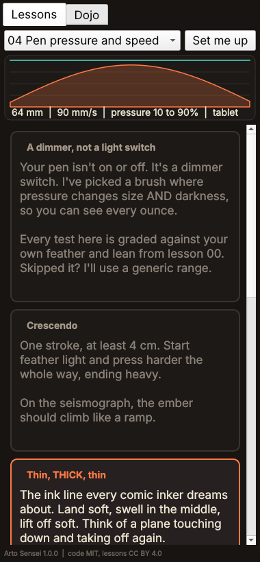
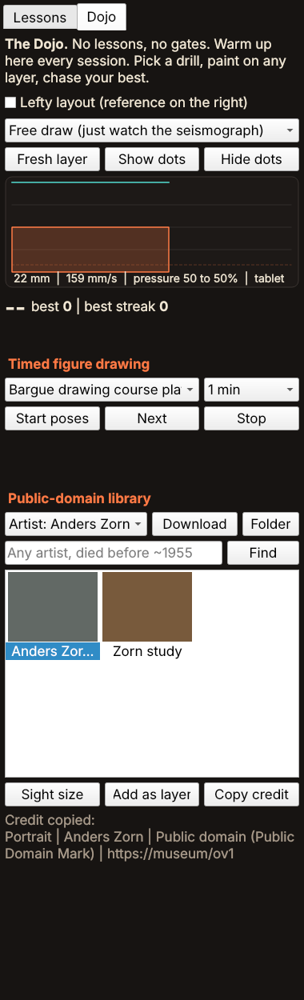

# Arto Sensei

**A Krita docker that teaches Krita, and the feel of digital painting.**

Students drown in interface, and nobody learns pen pressure, stroke speed or using the whole tablet by watching the teacher. Arto Sensei teaches the interface in small bites (scrolling story cards, then a tiny challenge you actually perform), and it reads your real pen pressure and speed on the real canvas, so it can coach *how* you make a mark, not just which key to press.

Teaching tool, not assessment tool: every card is open, click any title to test out, and progress never leaves your machine.

Part of **Seriously Open Games**. Code MIT, lessons CC BY 4.0, by Oscar Baechler.

<p>


</p>

## Install (Krita 5.3)

1. Download `arto-sensei-1.0.0.zip` from [Releases](../../releases).
2. In Krita: **Tools > Scripts > Import Python Plugin from File...** and pick the zip.
3. **Settings > Configure Krita > Python Plugin Manager**, tick **Arto Sensei**, OK, restart Krita.
4. **Settings > Dockers > Arto Sensei**.

Manual install: copy `arto_sensei.desktop` and the `arto_sensei/` folder into your pykrita folder (Windows `%APPDATA%\krita\pykrita`, Linux `~/.local/share/krita/pykrita`, macOS `~/Library/Application Support/krita/pykrita`).

Krita 6 (Qt6) is supported through one shim file, `qt.py`, but Krita 6 itself is still early access.

## The curriculum

| # | Lesson | # | Lesson |
|---|---|---|---|
| 00 | Tablet setup and your hand (calibrates YOUR pressure range) | 13 | Value 4: picking value with color dockers |
| 01 | Interface basics | 14 | Value 5: the ten-step scale, by eye |
| 02 | View navigation | 15 | Selections and transform |
| 03 | Brush anatomy | 16 | Bargue sight-size setup |
| 04 | Pen pressure and speed | 17 | The layer pipeline: flats, local, shadow, contact, rim, paintover |
| 05 | Brush hotkeys | 18 | Brush customization and the pop-up palette |
| 06 | Hand motion: hatching rhythm, crosshatch, ghosting | 19 | Blend modes, brushes and layers |
| 07 | Layers anatomy | 20 | Filter layers, masks, fills and flats |
| 08 | Layer hotkeys | 21 | Reference, mirror, second view, grids, assistants |
| 09 | Alpha lock, inherit alpha, quick clipping | 22 | Wrap-around mode for tileable textures |
| 10 | Value 1: building opacity | 23 | Saving, backups and the Recorder |
| 11 | Value 2: blend, mud mix, pick | 24 | Capstone: a Bargue master copy |
| 12 | Value 3: layers with lowered opacity | | |

Keyboard hints show **your** Krita's real shortcuts (custom keymaps teach correctly), and fall back to Krita's Canvas Input keys (1 2 3 zoom, 4 5 6 rotate) where no menu shortcut exists.

## The Dojo

A sandbox outside the lessons, for warming up every session:

- **Drills** with scores, streaks and personal bests: even pressure, swell (thin-thick-thin), steady speed, flick, hatching lanes with red dot guides.
- **Rhythm**: clean marks in 10 seconds. Quantity, not quality, so it stays fast.
- **Timed figure drawing**: 30 s to 10 min poses from the library, each on a fresh layer.
- **Lefty layout**: tick it once and every sight-size copy and pose puts the reference on the right, drawing on the left.
- **Public-domain library**: 11 themed sets (Bargue plates, master drawings, academic figure painters, portraitists, old masters, Golden Age illustrators, landscapes, naturalism, movements, animals and motion, sculpture) plus **Find artist** for any single name. Every image is license-checked to public domain or CC0, with its credit saved. A thumbnail grid loads as you scroll; double-click for a sight-size canvas, **Add as layer**, or **Copy credit**. With an Openverse login from Photobash CC, museum collections join Wikimedia Commons as a source. Details and pruning notes: [docs/library.md](docs/library.md).

> Copyright note: *William* Hogarth (1700s engravings) is public domain. *Burne* Hogarth (*Dynamic Anatomy*, 1958) is not, so he is not in the library.

## How it works

| Path | What |
|---|---|
| `arto_sensei/pen.py` | PenTap: an application-level Qt event filter that records tablet samples on the canvas (never consumes events). ActionLog watches Krita actions. |
| `arto_sensei/metrics.py` | Pure Python stroke math: speed, pressure ramp, taper, steadiness, straightness, reach. The coaching judge and Dojo scores. |
| `arto_sensei/checks.py` | 36 check types (view, actions, tools, dockers, brush, color, layers, layer stacks, selections, value boxes, pen strokes, rhythm counts). |
| `arto_sensei/krita_state.py` | Safe Krita state reads and lesson setups (value ladders, hatching guides, sight-size reference docs, practice layers). |
| `arto_sensei/library.py` | The public-domain library: themed sets, artist search, Commons + Openverse downloader, cached thumbnails, credits. |
| `arto_sensei/widgets.py`, `docker.py` | Seismograph, lesson cards, the Lessons and Dojo tabs. |
| `arto_sensei/lessons/` | `curriculum.json` (order) plus one JSON file per lesson. Edit these to write your own lessons. |
| `tests/` | Offscreen gym (fake `krita` module + real PyQt5 + real QTabletEvents) and the lesson validator. |

### Writing a lesson

```json
{"id": "crescendo", "title": "Crescendo",
 "body": "One stroke, light to heavy. Mirror with {key:mirror_canvas|M}.",
 "hint": "...", "setup": ["practice_layer", {"do": "rotate_view", "degrees": 35}],
 "check": {"type": "stroke", "criteria": {"min_length_mm": 40, "ramp_min": 0.6}},
 "praise": "..."}
```

Optional card keys: `buttons` (setups on a button), `quiet` (rhythm drills: a big counter, no graph). Run the validator before committing:

```
python tests/validate_lessons.py [path/to/actions_index.tsv]
python tests/gym_offscreen.py
python tools/package.py
```

## Traps we hit (so you don't)

- **Hollow View at startup.** While the splash is up, `activeView()` returns a View with no canvas; `View.flakeToCanvasTransform()` on it is a C++ null dereference that kills Krita. Everything Krita-facing waits for `krita_state.ready()`.
- **PyQt5 plus an uncaught exception in a slot or virtual means qFatal, and Krita dies.** Every Qt callback is wrapped in `devlog.safe`.
- **Don't filter pen events on the canvas widget.** Krita's input manager re-installs its filter on top and consumes tablet events, leaving only synthesized mouse events. Filter at the QApplication level.
- **Feather-light pressure can lift the tip mid-line** on some drivers; calibration stitches the pieces.
- **Shortcuts differ per install**, and zoom/rotate number keys live in the Canvas Input profile, not in menu actions.
- **Word-wrapped cards in a scroll area squash** unless the host layout uses `SetMinimumSize`.

## License

Code: MIT (`LICENSE`). Lessons, docs and screenshots: CC BY 4.0 (`CONTENT-LICENSE.md`). Credits: `ATTRIBUTION.md`.
